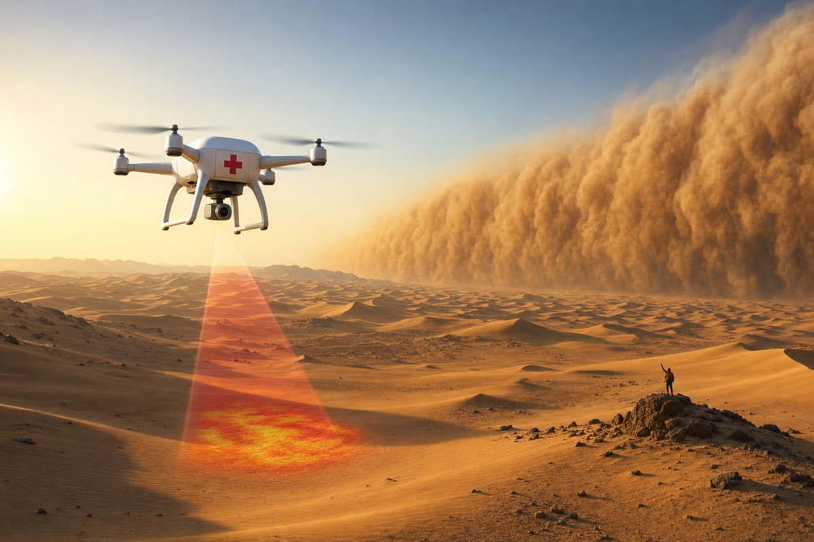
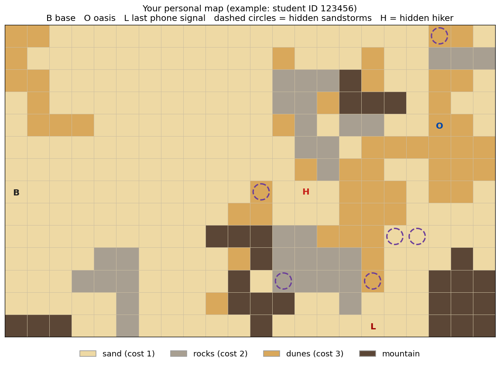
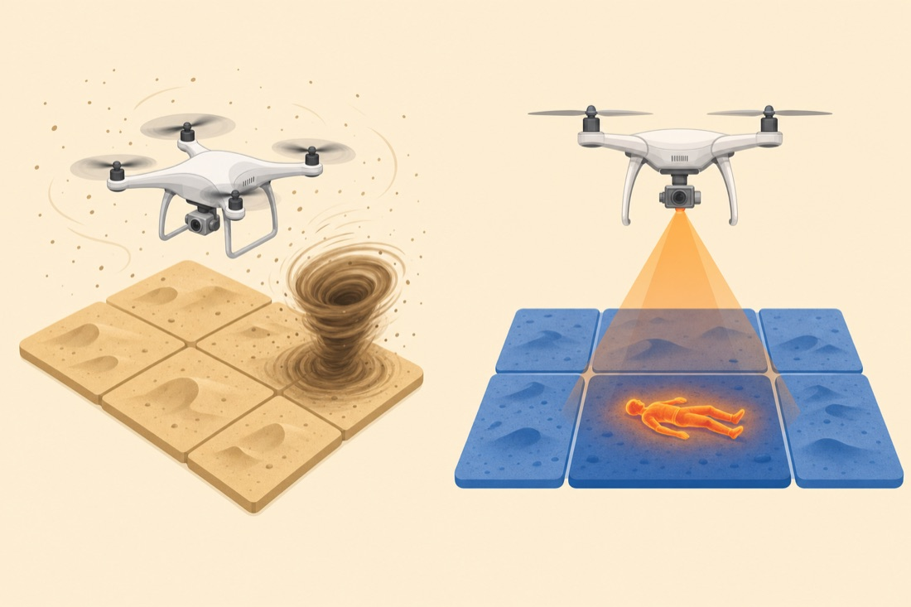
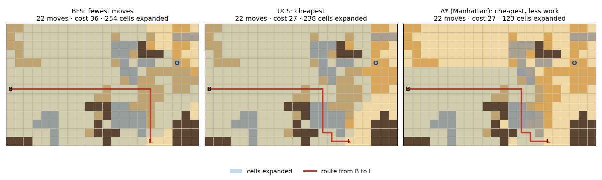
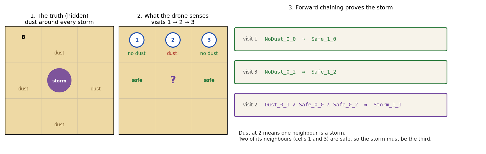
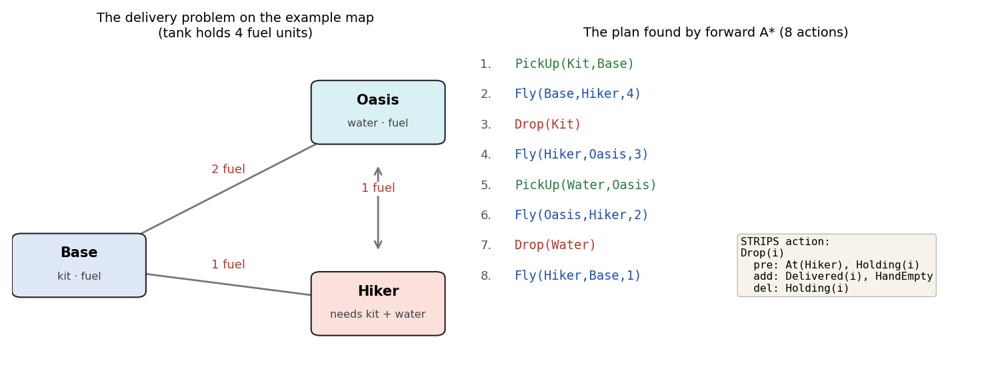
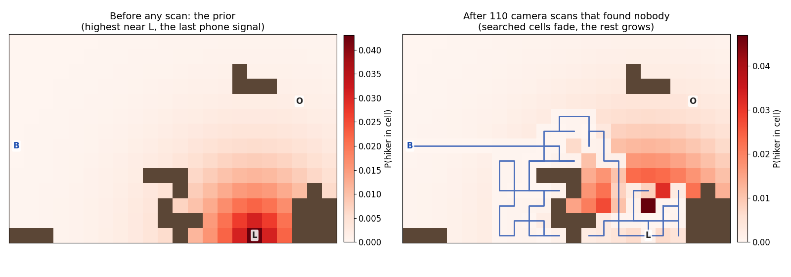
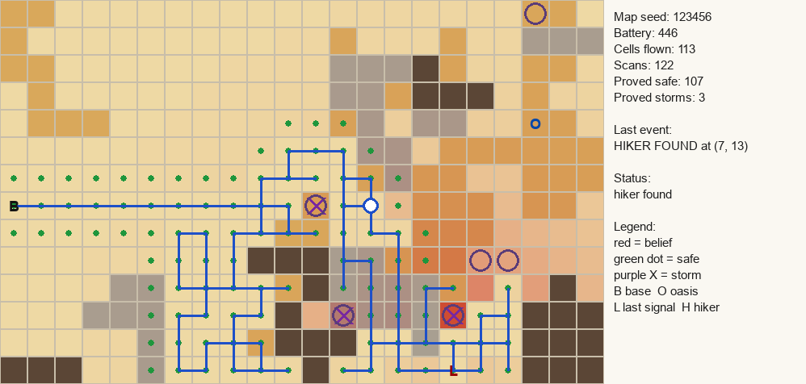

# Desert Rescue Drone — SE 444 Course Project (Fall 2026)



> **A hiker is lost in the Empty Quarter (الربع الخالي).** Their phone sent one last signal, then went silent.
> You program the rescue drone that must **find the hiker** and **deliver a medical kit and water**,
> without flying into a sandstorm.

You will build one rational agent that uses four ideas from the course:

| Phase | Idea from the course | What the drone does with it | Points |
|---|---|---|---|
| 1 | **Search** (BFS, UCS, A\*) — Lecture 3 | finds the cheapest route over sand, rocks and dunes | 25 |
| 2 | **Logic** (Horn rules, forward chaining) — Lecture 7 | proves which cells are safe and where the sandstorms are | 20 |
| 3 | **Planning** (STRIPS) — Lecture 9 | plans the delivery: pick up, fly, refuel, drop | 20 |
| 4 | **Probability** (Bayes' rule) — Lecture 10 | keeps a belief map of where the hiker is | 20 |
| 5 | **The full mission** | joins phases 1–4 into one agent | 5 |
| — | Report, video, repository | | 10 |
| | **Total** | | **100** |

**Deadline: Saturday 28 November 2026, 23:59.** Released Sunday 8 November 2026 (3 weeks). No extensions.

---

## 1. The world

This is what `python main.py --id 123456 --show` prints (123456 is an example ID):

```
    0123456789012345678901
  0 dd.................dd.        .  sand      cost 1   camera finds the hiker 90% of the time
  1 d...........d...d..rrr        r  rocks     cost 2   camera finds the hiker 70% of the time
  2 dd..........rrr#d..dd.        d  dunes     cost 3   camera finds the hiker 50% of the time
  3 .d..........rrd###.d..        #  mountain  cannot be crossed
  4 .ddd........dr.rr..Od.
  5 .............rr.dddddd        B  base: start, medical kit, fuel
  6 .............drdd..ddd        O  oasis: water and fuel
  7 B..........d...ddd.dd.        L  last phone signal of the hiker
  8 ..........dd...ddd....
  9 .........###rrddd.....        Hidden from the drone:
 10 ....rr....d#rrrrd...#.          sandstorms (flying in = crash)
 11 ...rrr....#.rrrrd..###          the hiker (probably near L)
 12 .....r...d###..r...###
 13 ###..r.....#....L..###
```

The same map as a picture, with the hidden sandstorms and hiker shown (your drone cannot see them):



**Your map is personal.** It is generated from your student ID. Two students never have the same
desert, storms or hiker. Your report must use **your** map.

The drone has two sensors:

- **Dust sensor.** In a cell next to a sandstorm (up, down, left or right), the drone feels dust.
  It cannot tell which neighbour is the storm.
- **Thermal camera.** It scans the cell under the drone. If the hiker is there, the camera sees them
  with probability 0.9 / 0.7 / 0.5 (sand / rocks / dunes). It never sees a hiker who is not there.



*Left: the dust sensor. Dust in the air means a storm is in a neighbouring cell, but not which one.
Right: the thermal camera sees a warm body only in the cell directly below the drone.*

The search flies **low** (the camera needs it), so sandstorms are deadly.
The delivery flies **high**, above the storms.

---

## 2. Getting started

**Step 1: make your own private copy.** On this GitHub page, click **Use this template → Create a new repository**.
Set it to **Private**. Then add the GitHub user **`aniskoubaa`** as a collaborator
(Settings → Collaborators). Do **not** fork this repository, because a fork is public.

**Step 2: clone, make an environment, install.** You need Python 3.10 or newer.

```bash
git clone https://github.com/<you>/<your-private-repo>.git
cd <your-private-repo>
```

Make an environment, so the project's packages stay separate from the rest of your computer. Pick **one** option:

```bash
# Option A: venv (comes with Python)
python -m venv .venv
source .venv/bin/activate              # macOS / Linux
.venv\Scripts\activate                 # Windows (PowerShell or cmd)

# Option B: conda (if you have Anaconda or Miniconda)
conda create -n desert python=3.11
conda activate desert
```

Then install the packages:

```bash
python -m pip install -r requirements.txt   # only pygame, for the animation
```

In VS Code, press `Ctrl/Cmd+Shift+P` → **Python: Select Interpreter**, and pick `.venv` or `desert`.

**Step 3: look at your map.**

```bash
python main.py --id 123456 --show       # use YOUR student ID
```

**Step 4: do Task 0 (warm-up, not graded).** `core/warmup.py` has two small functions. Use them
to practise the workflow before the real phases:

```bash
python main.py --test warmup            # shows TODO, then PASS once your code works
python main.py --id 123456 --phase warmup
```

**Step 5: work phase by phase.** For each phase, run its tests, then run the demo on your map:

```bash
python main.py --test search            # tests: warmup | search | logic | planning | bayes | mission | all
python main.py --id 123456 --phase search
```

| You edit | Phase |
|---|---|
| `core/warmup.py` | 0 – Warm-up (not graded) |
| `core/search.py` | 1 – Search |
| `core/logic.py` | 2 – Logic |
| `core/planning.py` | 3 – Planning |
| `core/bayes.py` | 4 – Probability |
| `agent/drone.py` → `plan_next_leg()` only | 5 – Mission |

Every place you must write code says `# YOUR CODE HERE` and raises `NotImplementedError`.
**Do not change** `world/`, `tests/`, `viz/`, `main.py`, or any code marked PROVIDED. Grading runs
the original versions of these files, so changing them will not help you.

---

## 3. The phases

Each file explains its functions in detail, with hints and examples. Here is the summary.

### Phase 1 — Search (`core/search.py`, 25 points)

Find routes on the map. Moving into a cell costs its terrain cost.

| Function | Returns |
|---|---|
| `manhattan(a, b)`, `euclidean(a, b)` | heuristic distances |
| `bfs(problem)` | the path with the **fewest moves** |
| `ucs(problem)` | the **cheapest** path |
| `astar(problem, heuristic)` | the cheapest path, expanding fewer cells |

Each returns a `SearchResult(path, cost, expanded)`. Use only `problem.neighbors()` and
`problem.cost()`, because in the mission the drone may only use cells it has proved safe.



*On the example map, all three routes have 22 moves. BFS ignores cost and crosses dunes (cost 36).
UCS and A\* find the cheapest route (cost 27), but A\* expands about half as many cells.*

### Phase 2 — Logic (`core/logic.py`, 20 points)

The drone writes what it senses as propositional symbols such as `Safe_2_3`, `Dust_2_3`
and `Storm_2_3`, and stores **Horn rules**:

```
NoDust_2_3                       ⇒  Safe_2_4          (no dust here: every neighbour is safe)
Dust_2_3 ∧ Safe_1_3 ∧ Safe_2_4   ⇒  Storm_3_3         (dust here, all other neighbours safe)
```

You write the knowledge base (`tell_fact`, `tell_rule`, `forward_chain`, `ask`) and
`percept_rules()`, which turns one dust reading into facts and rules.
Forward chaining proves new safe cells and finds storms.



### Phase 3 — Planning (`core/planning.py`, 20 points)

Once the hiker is found, the drone must deliver the **kit** (at Base) and **water** (at the Oasis),
carrying one item at a time, then return to Base. Fuel is limited (4 units). Each flight costs 1 or 2 units,
depending on the A\* route cost **on your map**. Refuelling is possible at Base and at the Oasis.

`Fly` and `Refuel` are provided. You write the **PickUp** and **Drop** action schemas,
`is_applicable`, `apply`, **forward BFS** over states, the **goal-count** heuristic, and **forward A\***.



*`Fly(Base,Hiker,4)` means "fly from Base to Hiker with 4 fuel units in the tank". Your map
gives different fuel costs, so your plan may be different (for example, it may need a refuel).*

### Phase 4 — Probability (`core/bayes.py`, 20 points)

The drone keeps `belief[cell] = P(hiker in cell | all scans so far)`. The starting belief (prior)
is highest near the last phone signal. When the camera sees **nothing** in cell *c*:

```
P(miss)       = 1 − belief[c] · d(c)
belief[c]    ← belief[c] · (1 − d(c)) / P(miss)
belief[x≠c]  ← belief[x] / P(miss)
```

You write `normalize`, `update_after_miss`, `detection_chance` and `choose_search_cell`.
The last one picks the cell with the best *chance of finding the hiker per unit of fuel*.



*Each scan that finds nobody lowers the belief of the scanned cell. The belief of every other
cell rises, so the drone moves on to the next most likely area.*

### Phase 5 — The mission (`agent/drone.py`, 5 points)

You write `plan_next_leg()`. It asks Bayes for the best cell among the cells logic has proved
safe, then asks A\* for a route that stays on safe cells. The provided loop flies the
drone, senses dust and scans at every cell, then plans the delivery once the hiker is found.

```bash
python main.py --id 123456 --phase mission --gui                 # watch it live
python main.py --id 123456 --phase mission --save mission.png    # picture for your report
```



*Blue line: the drone's trail. Green dots: cells proved safe. Purple X: storms proved by logic.
Rings: the true storms, shown at the end. Red shading: the belief map.*

The drone must **never crash**. On most maps it finds the hiker. On some maps the hiker sits
in a place your logic can never prove safe. That is not a bug. Explain it in your report.

---

## 4. Deliverables

Submit on Blackboard before the deadline:

1. **Private GitHub repository** link, with `aniskoubaa` added as a collaborator. Your final commit
   must be before the deadline. Commit regularly: your commit history is part of the evidence that
   you wrote the code.
2. **Report** (PDF, IEEE conference template, **max 4 pages**). Use the results from **your** map:
   - **Search:** the table from `--phase search`. Why does A\* expand fewer cells than UCS?
     Which heuristic expands fewer, Manhattan or Euclidean, and why?
   - **Logic:** one storm your drone proved, written as the chain of rules that proved it.
     Why are Horn rules enough here? Give one situation your KB cannot decide.
   - **Planning:** your delivery plan and the states expanded by BFS and A\*.
     Why is goal-count admissible **in this domain**?
   - **Probability:** derive the `update_after_miss` formula from Bayes' rule.
     Show the belief of one cell after 1, 2 and 3 misses. Why do dunes need more scans?
   - **Mission:** your result and the saved picture. If the hiker was not found, explain why.
3. **Video** (YouTube, unlisted, **max 3 minutes**): your mission running on your map, with
   your voice explaining what the drone is doing.

---

## 5. Grading

| Part | Points | How it is graded |
|---|---|---|
| Phase 1 – Search | 25 | hidden tests on your map + 3 other maps |
| Phase 2 – Logic | 20 | hidden tests: the exact safe and storm cells must match |
| Phase 3 – Planning | 20 | hidden tests: valid **and** shortest plans for many fuel settings |
| Phase 4 – Probability | 20 | hidden tests: exact belief values |
| Phase 5 – Mission | 5 | never crashes; finds the hiker when the reference finds it |
| Report | 5 | answers to the questions in section 4, on your map |
| Video | 3 | the mission running, with a clear explanation |
| Repository | 2 | clean, readable code; regular commits |
| **Bonus** | +5 | a **risk-aware drone**: when no safe cell is worth searching, it may enter an unknown cell whose storm chance is low. Estimate that chance with probability, and compare the success rate over 20 seeds in your report. |

Passing the public tests (`--test all`) is a good sign, but the hidden tests check more cases.

**Oral check.** Any student may be asked to explain their code in a 5-minute meeting.
If you cannot explain a function you submitted, that phase gets **0**.
The final exam includes questions on this project.

---

## 6. AI tools: what is allowed

The goal of this project is **practice**. You learn search, logic, planning and probability by writing
them yourself. An AI tool can be your **tutor**, but it must not be your **programmer**.

| ✅ Allowed (tutor) | ❌ Not allowed (programmer) |
|---|---|
| Asking an AI to **explain** a concept ("how does forward chaining work?") | Asking an AI to **write** or **complete** a function from this project |
| Asking what an error message means, or why your code fails a test, then fixing it yourself | Copilot **Agent** or **Edit** mode on this repository, or any tool that changes your files |
| Asking for a small example on a **different** problem (e.g. BFS on a toy graph) | Accepting inline suggestions inside a `# YOUR CODE HERE` block |
| GitHub Copilot **Chat in Ask mode** (free with the GitHub Student Developer Pack) | Copying code from other students or from last year |

**Copilot setup for this project:** use Chat in **Ask** mode, and turn off inline suggestions for this
workspace (click the Copilot icon in the status bar → disable completions).

If you used an AI tool for an idea, say so in a comment. Code you cannot explain counts as not yours,
and the oral check (section 5) will show it.

---

## 7. Suggested schedule

| Week | Work |
|---|---|
| 1 (8–14 Nov) | Phase 1 Search + Phase 2 Logic |
| 2 (15–21 Nov) | Phase 3 Planning + Phase 4 Probability (after the Bayes lecture) |
| 3 (22–28 Nov) | Phase 5 Mission, report, video |

## 8. FAQ

- **The mission test fails but my phase tests pass.** The mission uses all phases together.
  Run `--phase logic` and `--phase bayes` on your map and check the output makes sense.
- **`pygame` will not install.** Everything except `--gui` and `--save` works without it.
  Ask for help in the lab.
- **Can I change the costs or the map size?** For your own experiments, yes, on a separate branch.
  The graded code must work with the original world.
- **Questions:** post on the course forum, or come to office hours.
